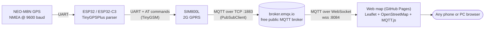
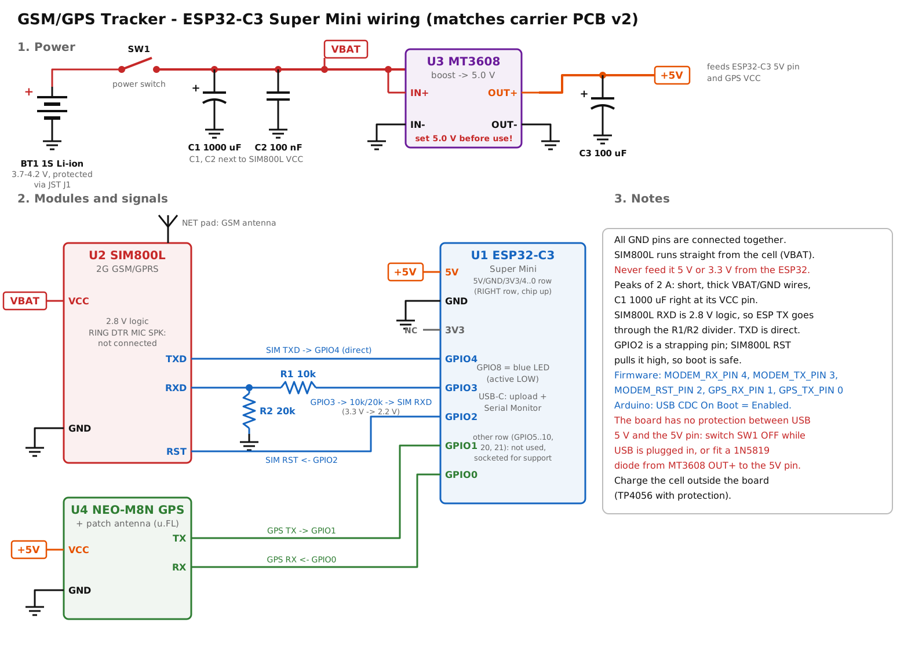
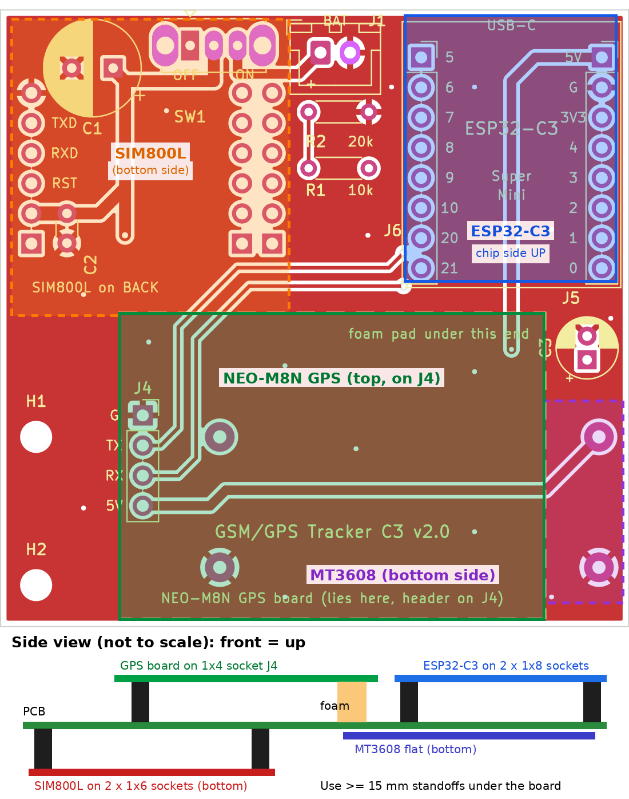
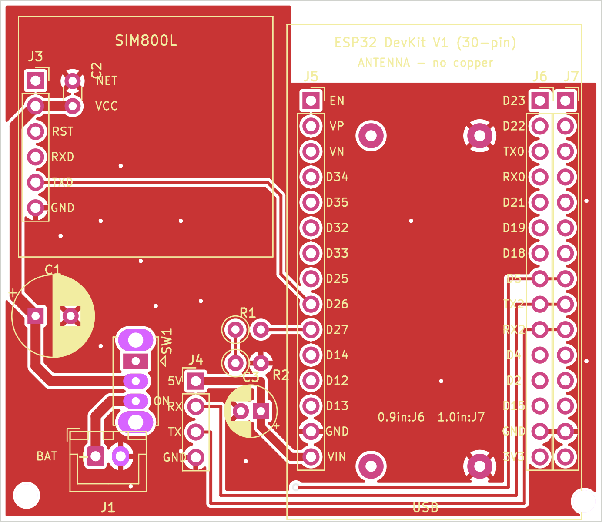

# GSM/GPS Live Vehicle Tracker

**ESP32 / ESP32-C3 + NEO-M8N GPS + SIM800L (2G) → MQTT → live web map**

A low-cost live tracker for cars, bikes and EV three-wheelers. The device reads its position from a NEO-M8N GPS module and sends it over 2G GPRS (SIM800L) every 5 seconds. A static web page shows it live on a map.

The whole system runs with **no server, no PC and no paid service**:

- The device publishes to a free public MQTT broker.
- The map page is a single HTML file on GitHub Pages.
- It subscribes to the same broker over a secure WebSocket.

**Live map:** <https://abdullah-atif.github.io/gps-tracker/#key=YOUR_TRACKER_KEY>

Author: **Abdullah Atif**, Department of EEE, BUET.

---

## Contents

- [How it works](#how-it-works)
- [Hardware](#hardware)
- [Repository layout](#repository-layout)
- [Quick start](#quick-start)
- [Wiring](#wiring)
- [Carrier PCBs](#carrier-pcbs)
- [Data format](#data-format)
- [Design decisions](#design-decisions)
- [Troubleshooting](#troubleshooting)
- [Project status](#project-status)
- [Security note](#security-note)
- [License](#license)

---

## How it works



1. **Read the position.** The ESP32 parses NMEA sentences from the GPS: position, speed, course, altitude, satellites and HDOP.
2. **Connect.** The SIM800L brings up GPRS. Then the ESP32 opens an MQTT connection on plain TCP port 1883. The SIM800L's built-in TLS is too old for modern servers, so plain MQTT is the reliable choice.
3. **Publish.** Every 5 s the device publishes a JSON message as a **retained** message. A page opened later still shows the last known position immediately.
4. **Online/offline status.** The device registers an MQTT **Last Will** (`offline`). If the device loses power or network, the broker publishes it automatically, and the map shows the tracker as offline.
5. **Show the map.** The web page subscribes to `gpstrk/<TRACKER_KEY>/+/loc` and `/status`. It:
   - draws a heading arrow for each device
   - keeps a trail in the browser
   - shows speed, satellites, HDOP and battery voltage.

---

## Hardware

| Part | Notes |
|---|---|
| ESP32 DOIT DevKit V1 (30-pin) **or** ESP32-C3 Super Mini | The DevKit version is tested end to end. The C3 version is a smaller board. |
| NEO-M8N GPS module + patch antenna | 9600 baud default. The antenna must see the sky. |
| SIM800L mini module + antenna | 2G only. Needs a SIM with a data plan and 2G coverage. |
| 1S Li-ion cell (18650 / LiPo, protected) | Powers the SIM800L directly (3.4–4.4 V). |
| MT3608 boost module | 1S cell → 5.0 V for the ESP32 and GPS. |
| 1000 µF + 100 nF capacitors | Next to SIM800L VCC, to absorb the 2 A transmit bursts. |
| 10 kΩ + 20 kΩ resistors | Level divider: ESP32 TX (3.3 V) → SIM800L RXD (2.8 V logic). |
| Slide switch, JST-XH connector | Power switch and battery plug. |

---

## Repository layout

```
gsm-gps-tracker/
├── esp32_devkit/                ESP32 DevKit V1 version (tested)
│   ├── gps_test/                  GPS check with baud-rate auto-detect
│   ├── sim800l_test/              7 PASS/FAIL checks: power, SIM, signal, GPRS, broker TCP
│   ├── sim800l_autodetect/        finds TX/RX orientation + baud, saves 9600 baud in the modem
│   ├── mqtt_sim800l_tracker/      THE TRACKER (2G GPRS)
│   ├── mqtt_wifi_tracker/         same tracker over Wi-Fi / phone hotspot (with network diagnostics)
│   └── pcb/                       KiCad carrier board (60 x 52 mm), Gerbers, BOM, generator
├── esp32c3_supermini/           ESP32-C3 Super Mini version
│   ├── c3_gps_test/
│   ├── c3_sim800l_autodetect/
│   ├── c3_mqtt_sim800l_tracker/   tracker + battery voltage report
│   ├── c3_wiring_diagram.png/.svg full wiring diagram
│   ├── c3_supermini_pinout.png    top/bottom pinout of the Super Mini
│   └── pcb/                       KiCad carrier board v2 (53 x 52 mm), all modules plug in
├── web/index.html               live map page (single file, no build step)
├── LICENSE
└── README.md
```

Each PCB folder has its own README with ordering and assembly notes.

---

## Quick start

### 1. Arduino IDE

1. Install the **esp32 by Espressif Systems** board package.
2. Install these libraries from Library Manager:

| Library | Author |
|---|---|
| TinyGPSPlus | Mikal Hart |
| TinyGSM | Volodymyr Shymanskyy |
| PubSubClient | Nick O'Leary |

3. Pick the board settings:

| Version | Board | Extra setting |
|---|---|---|
| DevKit | **ESP32 Dev Module** | - |
| C3 Super Mini | **ESP32C3 Dev Module** | **Tools → USB CDC On Boot → Enabled** (required for the Serial Monitor) |

### 2. Run the sketches in order

| Step | DevKit sketch | C3 sketch | What to look for |
|---|---|---|---|
| 1 | `gps_test` | `c3_gps_test` | Satellites > 0 and a fix outdoors (first fix can take 1–5 min) |
| 2 | `sim800l_test` | - | All 7 checks PASS |
| 2b | `sim800l_autodetect` | `c3_sim800l_autodetect` | `FOUND` with the right TX/RX orientation; modem saved at 9600 baud |
| 3 | `mqtt_sim800l_tracker` | `c3_mqtt_sim800l_tracker` | `published` lines in the Serial Monitor |

### 3. Configure the tracker

At the top of the tracker sketch:

```cpp
const char APN[]         = "gpinternet";             // Grameenphone; Robi/Airtel "internet", Banglalink "blweb"
const char* TRACKER_KEY  = "change-this-secret-key"; // long random text, also used in the map link
const char* DEVICE_ID    = "car-01";                 // one ID per vehicle
```

### 4. Open the map

```
https://abdullah-atif.github.io/gps-tracker/#key=YOUR_TRACKER_KEY
```

You can also open `web/index.html` from disk or host it yourself. Anyone with the link, key included, can watch the tracker. Several devices with the same key appear on the same map.

---

## Wiring

### ESP32-C3 Super Mini



| ESP32-C3 pin | Connects to | Firmware define |
|---|---|---|
| 5V | MT3608 OUT+ (5.0 V) | - |
| GND | common GND | - |
| GPIO4 | SIM800L TXD | `MODEM_RX_PIN 4` |
| GPIO3 | 10 kΩ → SIM800L RXD (20 kΩ from RXD to GND) | `MODEM_TX_PIN 3` |
| GPIO2 | SIM800L RST | `MODEM_RST_PIN 2` |
| GPIO1 | GPS TX | `GPS_RX_PIN 1` |
| GPIO0 | GPS RX | `GPS_TX_PIN 0` |
| GPIO8 | on-board LED (active LOW), blinks on each publish | `LED_PIN 8` |

> The Super Mini's pin labels are printed on its **underside**. Seen from the top (chip side up, USB-C up), the 5V / GND / 3V3 / GPIO4..0 row is on the **right**. See [`c3_supermini_pinout.png`](esp32c3_supermini/c3_supermini_pinout.png).

### ESP32 DevKit V1

| ESP32 pin | Connects to | Notes |
|---|---|---|
| GPIO16 (RX2) | GPS TX | |
| GPIO17 (TX2) | GPS RX | |
| VIN (5 V) | GPS VCC | from the MT3608 5.0 V output |
| GPIO26 | SIM800L TXD | direct |
| GPIO27 | SIM800L RXD | through the 10k/20k divider |
| GPIO5 | SIM800L RST | optional |
| GND | common GND | |

### Power (both versions)

```
1S Li-ion ─ switch ─ VBAT ─┬─ SIM800L VCC   (1000 µF + 100 nF right at the module)
                           └─ MT3608 IN+ ─ 5.0 V ─┬─ ESP32 5V / VIN  (100 µF)
                                                  └─ GPS VCC
```

- **Never power the SIM800L from the ESP32's 3.3 V or 5 V pin.** It draws up to 2 A in short bursts.
- **Set the MT3608 to 5.0 V with a multimeter before connecting anything.** New modules often ship at 12 V or more.
- The C3 Super Mini has no protection between USB 5 V and its 5V pin. Switch the battery off while USB is plugged in.

---

## Carrier PCBs

Both boards are 2-layer, through-hole only, and generated by Python scripts using the KiCad 7 `pcbnew` API. Each folder contains:

- the `.kicad_pcb` file
- Gerbers (ready for JLCPCB / PCBWay)
- BOM, DRC report and renders.

Altium users: **File → Import Wizard → KiCad Design Files**, then repour the polygons.

| ESP32-C3 Super Mini carrier v2 (53 x 52 mm) | ESP32 DevKit carrier v1 (60 x 52 mm) |
|---|---|
|  |  |
| Every module plugs into sockets on **all** of its pins. ESP32-C3 and GPS on top; SIM800L and MT3608 underneath. | DevKit, SIM800L and power parts on the board; GPS on a 4-pin cable header. |

Before ordering, read the "Check before ordering" list in each PCB README. The module footprints of the C3 board were estimated from the real modules and must be checked against yours:

- SIM800L row spacing (two footprint options are provided)
- GPS header order
- Super Mini pin labels

---

## Data format

| Topic | Payload | Retained |
|---|---|---|
| `gpstrk/<TRACKER_KEY>/<DEVICE_ID>/loc` | JSON position (below) | yes |
| `gpstrk/<TRACKER_KEY>/<DEVICE_ID>/status` | `online` / `offline`; `offline` is the MQTT Last Will | yes |

```json
{
  "device_id": "car-01",
  "fix": true,
  "lat": 23.810331,
  "lng": 90.412521,
  "speed_kmh": 18.52,
  "course": 274.3,
  "alt_m": 14.2,
  "sats": 9,
  "hdop": 0.98,
  "batt_mv": 3987,
  "gps_time": "2026-10-06T10:15:42Z"
}
```

Fields are sent only when valid. `batt_mv` is measured by the SIM800L and reported by the C3 firmware.

---

## Design decisions

| Option | Result |
|---|---|
| Own HTTP server on a PC + tunnel | Works, but the PC must stay on. Rejected for a vehicle. |
| Free cloud hosts | Force HTTPS, which the SIM800L cannot do reliably, or need a credit card, or have idle shutdowns and request limits. |
| **Public MQTT broker + static page on GitHub Pages** | **Chosen.** The SIM800L speaks plain MQTT on 1883 and the browser uses secure WebSocket on 8084. No server to maintain, free, and a retained message plus Last Will give "last known position" and online/offline status for free. |

---

## Troubleshooting

| Symptom | Cause / fix |
|---|---|
| SIM800L resets, LED blinks fast forever, no network | Power. It needs 2 A peaks: short thick wires, 1000 µF at VCC, common GND. |
| Garbage characters or no `OK` from the SIM800L | Wrong baud rate or swapped TX/RX. Run `sim800l_autodetect`; it tests both orientations and all common bauds. |
| Module answers calls but the ESP32 gets nothing | Same as above. Also check that the divider is on the **RXD** line, not TXD. |
| Wi-Fi hotspot connected but no internet on the ESP32 | Many Bangladeshi mobile networks hand out IPv6 only. Set the phone's APN protocol to **IPv4/IPv6**. Not an issue with the SIM800L. |
| Position 30–70 m off | Poor sky view (HDOP > 5, about 4 satellites). Outdoors with 8+ satellites and HDOP < 2 gives about 2–5 m. |
| Map shows "waiting for data" | Device online but no fresh fix yet, or the key in the link does not match `TRACKER_KEY`. |
| ESP32-C3 shows nothing in the Serial Monitor | Enable **USB CDC On Boot**. |

---

## Project status

- [x] GPS test and baud auto-detect
- [x] SIM800L test and orientation/baud auto-detect
- [x] Live tracking over 2G (ESP32 DevKit + SIM800L), verified on the live map
- [x] Wi-Fi / hotspot variant with network diagnostics
- [x] Web map: multiple devices, trail, online/offline, speed, satellites, HDOP, battery
- [x] ESP32-C3 Super Mini firmware and carrier PCB v2 design
- [ ] ESP32-C3 firmware tested on hardware
- [ ] Carrier PCBs fabricated and tested
- [ ] Optional: LoRa variant for SIM-free tracking in a limited area

---

## Security note

The MQTT broker is public. The only secret is `TRACKER_KEY`, which is part of the topic name:

- Use a long random key.
- Share the map link only with people who should see the vehicle.

This is a hobby/student project. Do not rely on it for safety-critical or anti-theft use.

---

## License

[MIT](LICENSE) © 2026 Abdullah Atif
