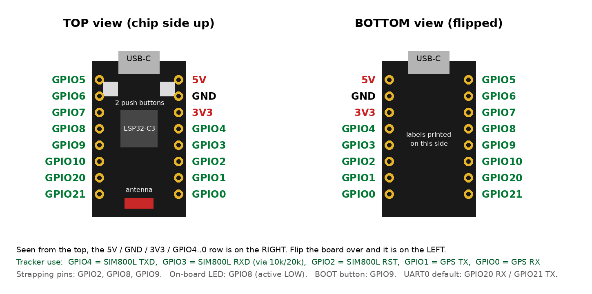

# GSM/GPS Tracker: ESP32-C3 Super Mini version

This version replaces the ESP32 DevKit with the much smaller **ESP32-C3 Super Mini** (22.5 x 18 mm). It uses the same MQTT broker, topics, JSON format and web page as the DevKit version, so the map at `https://abdullah-atif.github.io/gps-tracker/#key=...` works unchanged.


## Folder contents

| Folder | Purpose |
|---|---|
| `c3_gps_test/` | Checks the GPS on the C3 pins |
| `c3_sim800l_autodetect/` | Checks SIM800L wiring and baud rate, then fixes the modem at 9600 baud |
| `c3_mqtt_sim800l_tracker/` | The tracker firmware |
| `pcb/` | KiCad 7 board, Gerbers, BOM, renders and generator script |

Run the sketches in this order: GPS test → SIM800L autodetect → tracker.

## Arduino IDE settings (important)

| Setting | Value |
|---|---|
| Board | **ESP32C3 Dev Module** |
| Tools → USB CDC On Boot | **Enabled** (otherwise there is no Serial Monitor over USB, and UART0 is taken) |
| Libraries | TinyGPSPlus, TinyGSM, PubSubClient |

The ESP32-C3 has only two hardware UARTs:

- **UART0** (`HardwareSerial(0)`) is used for the GPS.
- **UART1** is used for the SIM800L.
- The Serial Monitor runs over native USB.

## Wiring diagram


`c3_wiring_diagram.svg` is the same diagram as a vector file. `make_wiring_diagram.py` regenerates both: `python3 make_wiring_diagram.py c3_wiring_diagram.svg c3_wiring_diagram.png`.

## Pin map (PCB v2)



The pin labels are printed on the **underside** of the Super Mini. Seen from the top (chip side up, USB-C up), the 5V / GND / 3V3 / GPIO4..0 row is on the **right**. Flip the board and it is on the left. All signals use this row; the other row (GPIO5..10, 20, 21) only holds the board mechanically.

| Super Mini pin | Connected to | Firmware define |
|---|---|---|
| 5V | MT3608 boost output (5.0 V) | - |
| GND | GND | - |
| GPIO4 | SIM800L TXD | `MODEM_RX_PIN 4` |
| GPIO3 | SIM800L RXD, through the 10k/20k divider (2.8 V logic) | `MODEM_TX_PIN 3` |
| GPIO2 | SIM800L RST (strapping pin; the SIM800L pull-up keeps it high at boot) | `MODEM_RST_PIN 2` |
| GPIO1 | GPS TX | `GPS_RX_PIN 1` |
| GPIO0 | GPS RX | `GPS_TX_PIN 0` |
| GPIO8 | On-board blue LED (active LOW; blinks on every published report) | `LED_PIN 8` |

> PCB v1 had GPIO3/GPIO4 the other way round. The sketches in this folder are already set for v2. If you hand-wire a v1 board, swap `MODEM_RX_PIN` and `MODEM_TX_PIN`, or just run `c3_sim800l_autodetect`, which finds the orientation by itself.

## Carrier PCB v2 (`pcb/`)

Every module plugs straight into the board. Nothing hangs on jumper wires. Each module sits in female sockets that take **all** of its pins, unused ones included, so it is held on both sides.

- 2 layers, **53 x 52 mm**.
- **Front side:**

  | Part | Mounting |
  |---|---|
  | ESP32-C3 Super Mini | 2 x 1x8 sockets, **chip side up**, USB-C at the top edge. J5 (right) = 5V/GND/3V3/4..0 row, J6 (left) = GPIO5..21 row |
  | NEO-M8N GPS board | 1x4 socket J4; the board lies flat over the lower half |
  | Power parts | JST battery connector J1, slide switch SW1, 1000 µF + 100 nF (SIM800L), 100 µF (5 V), 10k/20k divider |

- **Back side:**

  | Part | Mounting |
  |---|---|
  | SIM800L mini | Interface row (GND TXD RXD RST VCC NET) in J3. Audio row (RING DTR MIC SPK, no connection) in J8 **or** J9 |
  | MT3608 boost module | Lies flat, connected by its 4 pads |

- Power path:

  ```
  1S Li-ion → SW1 → VBAT → SIM800L
                         → MT3608 → 5 V → C3 5V pin + GPS VCC
  ```

- Design rule check: **0 unconnected items.** The only error is the intended J8/J9 courtyard overlap, because they are two alternative positions and only one gets fitted. The remaining warnings are cosmetic: silkscreen overlap and library-link notices.
- **Altium:** File → Import Wizard → KiCad Design Files → `gsm_tracker_c3.kicad_pcb`, then repour the polygons.
- **Fabrication:** upload `gsm_tracker_c3_gerbers.zip` to JLCPCB or PCBWay.

### Assembly

1. **MT3608 first.** Set it to **5.0 V** on the bench, then solder it flat on the back. Use short wire legs or cut component leads through its IN+/IN-/OUT+/OUT- holes.
2. **Back sockets.** Solder J3 and either J8 or J9 on the back, from the front side.
3. **Front parts.** Solder J5, J6, J4 and the rest of the front parts.
4. **SIM800L.** Plug it in from the back. Its component side faces away from the board and the antenna end points down, as printed on the back silkscreen.
5. **GPS board.** Plug it into J4. Stick a foam pad (about 11 mm, or stacked foam tape) or a nylon spacer under its far end so it lies level. Place the patch antenna on top, facing the sky.
6. **Standoffs.** Mount the board on **15 mm or taller** standoffs (M2, holes H1/H2), because the SIM800L hangs under it.

### Check before ordering (dimensions were estimated from the breadboard photo)

1. **SIM800L orientation.** Hold the module component side up with the antenna end towards you. The interface row (NET VCC RST RXD TXD GND) must be on the **right**, with **NET nearest the antenna end**. If your module is mirrored, tell me and I will flip the footprint.
2. **SIM800L row spacing.** Measure from the centre of a pin in one row to the centre of the facing pin in the other row:
   - about **17.8 mm**: fit **J8**
   - about **20.3 mm**: fit **J9**
   - any other value: send me the measurement.
3. **GPS header order.** With the header on the left and the board body to the right, the pins from top to bottom must read **GND, TX, RX, VCC**. Check the labels printed on your GPS board.
4. **GPS board size.** The board assumes about 36 x 26 mm (dashed outline on the front silkscreen). A slightly larger board is fine, because it sits above the other parts.
5. **Super Mini pin order.** Turn your board over and read the printed labels with USB-C at the top. They must read:
   - Left row (bottom view): 5V, G, 3.3, 4, 3, 2, 1, 0
   - Right row (bottom view): 5, 6, 7, 8, 9, 10, 20, 21

   This is the common layout. If your labels differ, do not use this PCB as is.
6. **Battery.** Use a protected cell and charge it outside the board. The firmware reports the cell voltage (`batt_mv`), measured by the SIM800L, in every message.
